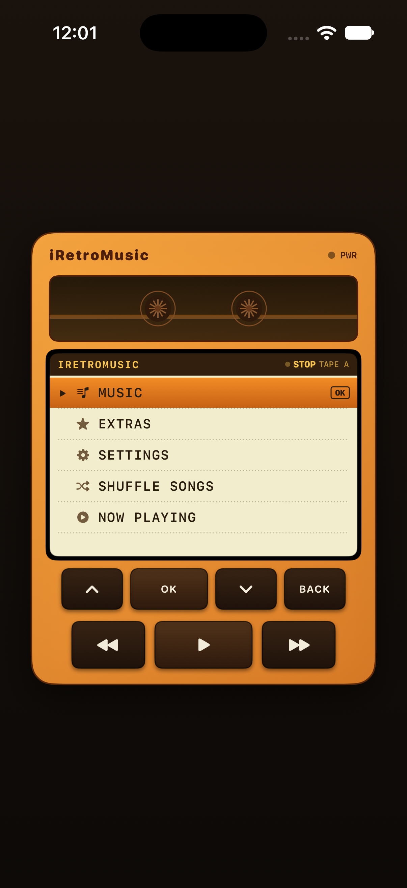
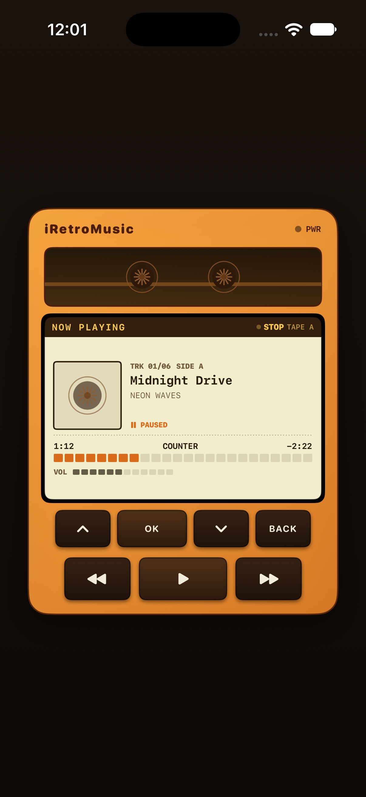
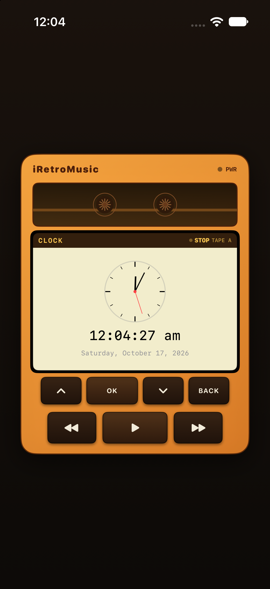
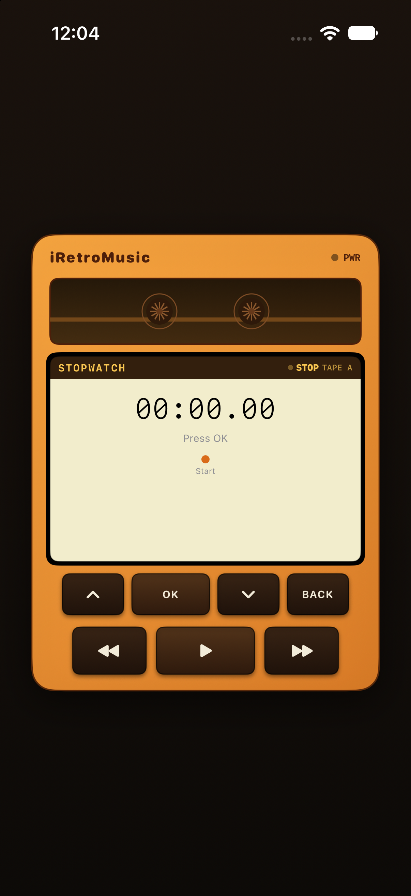
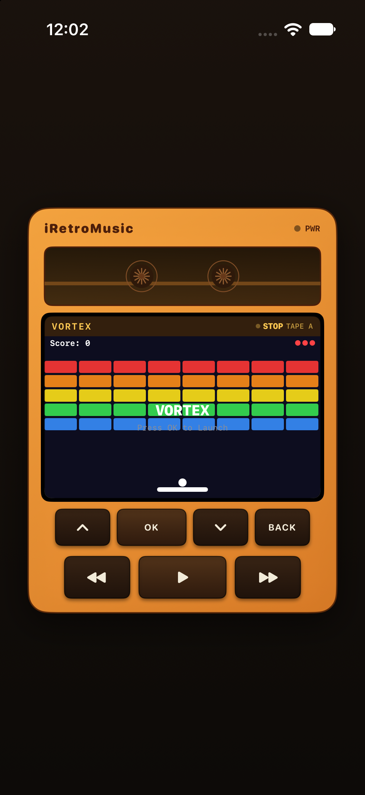
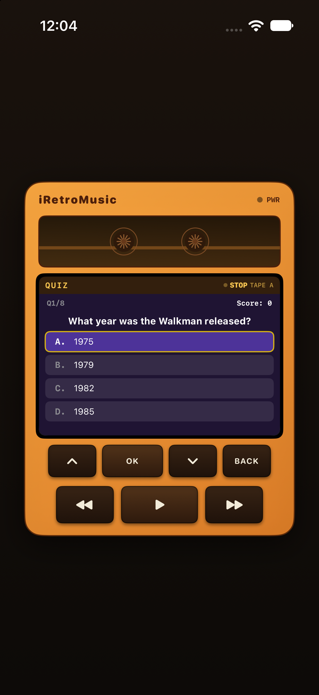

# iRetroMusic

A cassette-era portable music player for iOS, built entirely in SwiftUI. Features a cassette-deck style tactile-button interface, hierarchical menu system, Apple Music playback, and classic retro games.

## Screenshots

| Main Menu | Now Playing | Clock |
|---|---|---|
|  |  |  |

| Stopwatch | Vortex | Quiz |
|---|---|---|
|  |  |  |

## Features

### Cassette Deck Tactile Controls
- **Up / Down** — scroll through menus
- **OK** — select / confirm
- **BACK** — return to previous menu
- **Prev / Play-Pause / Next** — transport row for playback control
- Haptic feedback on every interaction
- Animated cassette-tape window that spins while playing

### Music Player
- Browse your Apple Music library by song or album
- Now Playing screen with album artwork, progress bar, and volume indicator
- Track-to-track advancement and shuffle mode
- Real playback via MusicKit

### Retro Games
- **Vortex** — a brick-breaker game controlled by the navigation buttons
- **Solitaire** — card-matching memory game
- **Quiz** — music trivia
- **Clock** and **Stopwatch** utilities

### Device Aesthetic
- Warm orange-and-cream cassette-player body with embossed brand strip
- Vintage-LCD-tinted screen with cassette-style "REC / STBY" status indicator
- Tactile dark-plastic buttons with press animation
- iPad layout: tabbed card-grid library (Tracks / Albums / Player) with mini-player bar

## Requirements

- iOS 18.5+
- Xcode 16.0+
- Swift 5.9+

## Getting Started

1. Clone the repository
2. Open `MusicPlayer.xcodeproj` in Xcode
3. Build and run on a simulator or device

## Architecture

- **SwiftUI** — entire UI layer
- **Combine** — reactive state management and timers
- **MusicKit** — Apple Music library access and playback
- **MVVM** — `RetroPlayerViewModel` manages all navigation, playback, and menu state
- `ContentView.swift` contains the device shell, controls, and screen views
- `ExtrasViews.swift` contains Clock, Stopwatch, Solitaire, and Quiz
- `VortexGameView.swift` contains the brick-breaker game engine

## License

MIT
